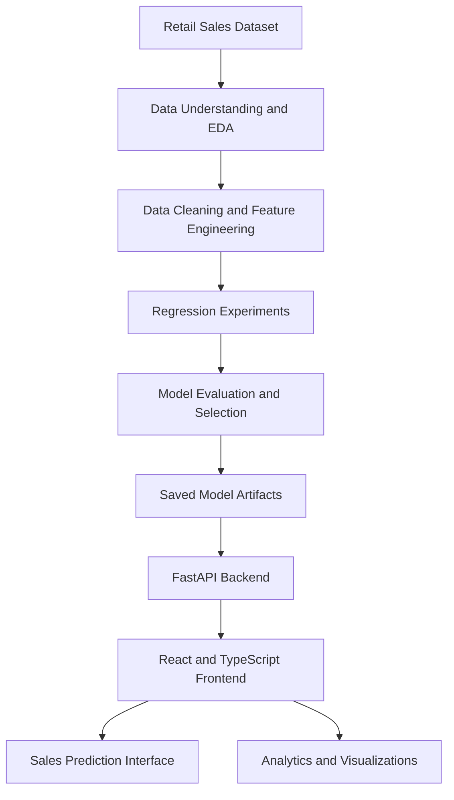

# Retail Store Sales Predictor
### From Retail Data Analysis to Machine Learning-Powered Sales Insights

**A full-stack machine learning project exploring retail sales data, regression modelling, predictive analytics, and interactive data visualization.**

<p align="center">
  <a href="https://github.com/rahathussainrahi/sales_predictor">
    
  </a>
  
  
  
</p>

---

## Project Overview

The **Retail Store Sales Predictor** is an end-to-end machine learning project developed to explore retail data, investigate the factors associated with sales, experiment with regression models, and make predictive analytics accessible through a web application.

The project brings together data analysis notebooks, feature engineering, model development, a FastAPI backend, and a React-based frontend. Its goal is to demonstrate how a machine learning workflow can move beyond experimentation in notebooks toward an application that users can interact with.

**Project repository:** [github.com/rahathussainrahi/sales_predictor](https://github.com/rahathussainrahi/sales_predictor)

## Project Objectives

- Explore and understand retail sales data through structured exploratory data analysis.
- Investigate data quality, distributions, relationships, and useful predictive features.
- Develop and evaluate regression-based sales prediction models.
- Build a reusable prediction pipeline that can be accessed through an API.
- Present data insights, model information, and predictions through an interactive dashboard.
- Identify limitations and improvements needed for reliable real-world use.

## Technology Stack

| Area | Technologies |
|---|---|
| Programming | Python, JavaScript, TypeScript |
| Data analysis | Jupyter Notebook, pandas, NumPy, data visualization libraries |
| Machine learning | Regression modelling, feature engineering, model evaluation |
| Backend | FastAPI, Pydantic-style request/response schemas |
| Frontend | React, TypeScript, Vite |
| Dashboard visualization | Recharts |
| Development tools | Git, GitHub, Python virtual environments |

*The exact versions and installed packages should be confirmed against the repository's dependency files.*

## System Architecture

The project follows a layered architecture that connects data analysis and machine learning with an interactive application.



### How the workflow operates

1. **Data exploration:** Understand the dataset, its structure, distributions, and quality.
2. **Feature engineering:** Prepare model inputs and transform relevant variables.
3. **Model development:** Experiment with regression approaches and improve the prediction workflow.
4. **Model serving:** Expose prediction and analytical functionality through API endpoints.
5. **Frontend integration:** Connect the web interface to the backend and present information visually.
6. **Validation and improvement:** Review model evaluation, API reliability, and the clarity of predictions.

## Machine Learning Workflow

The repository contains a sequence of notebooks covering the main stages of the project.

| Stage | Focus |
|---|---|
| 1. Data Understanding | Dataset structure, columns, data types, and initial inspection |
| 2. Exploratory Data Analysis | Distributions, trends, relationships, and visual exploration |
| 3. Feature Engineering | Preparing and transforming features for modelling |
| 4. Linear Regression | Establishing a regression modelling approach |
| 5. Model Evaluation | Examining predictive performance and evaluation measures |
| 6. Model Improvement | Investigating ways to improve the modelling workflow |
| 7. Prediction System | Connecting the selected workflow to prediction functionality |

The notebooks are intended to make the analytical process understandable and provide a progression from raw data toward a usable prediction system.

## Application Features

The backend exposes functionality for several parts of the application.

- **Project overview:** Summary information for the dashboard.
- **Dataset insights:** Access to dataset-related information.
- **Data quality:** Explore data-quality information.
- **Exploratory analysis:** Retrieve analytical summaries and visualization data.
- **Feature information:** Inspect information about the model's input features.
- **Sales prediction:** Submit input values and obtain a model prediction.
- **What-if analysis:** Explore alternative input scenarios.
- **Model information:** Access model-related details.
- **Model evaluation:** Retrieve evaluation and diagnostic information.

### API Endpoints

The following endpoints were identified during code review. Their successful runtime behavior should be verified in a running environment.

| Endpoint | Purpose |
|---|---|
| `GET /api/overview` | Overview data |
| `GET /api/dataset` | Dataset information |
| `GET /api/data-quality` | Data-quality information |
| `GET /api/eda` | Exploratory analysis |
| `GET /api/features` | Feature information |
| `POST /api/predict` | Generate a sales prediction |
| `POST /predict` | Alternative prediction route |
| `POST /api/what-if` | Explore a what-if scenario |
| `GET /api/model` | Model information |
| `GET /api/model/evaluation` | Model evaluation diagnostics |

For the exact request and response formats, inspect the backend schema definitions and API documentation after starting the service.

## Repository Structure

The repository contains notebooks, backend code, frontend code, datasets, model artifacts, and supporting files. A simplified view of the main components is shown below.

```text
sales_predictor/
│
├── backend/
│   ├── main.py
│   ├── predictor.py
│   ├── schemas.py
│   └── analytics.py
│
├── frontend/
│   └── src/
│       ├── services/
│       │   └── api.ts
│       └── ...
│
├── notebooks/
│   └── Learning and modelling notebooks
│
├── data/
│   └── Dataset and prepared data files
│
├── Model artifacts
├── requirements.txt
└── README.md
```

*This is a simplified overview, not a complete directory listing. Consult the repository for the actual file and folder names.*

## Getting Started

### Prerequisites

Install the following before running the project:

- Python and pip
- Node.js and npm
- Git
- A compatible Python environment for the saved model artifacts

### 1. Clone the repository

```bash
git clone https://github.com/rahathussainrahi/sales_predictor.git
cd sales_predictor
```

### 2. Set up the Python environment

Create and activate a virtual environment.

**Windows:**

```bash
python -m venv .venv
.venv\Scripts\activate
```

**macOS / Linux:**

```bash
python3 -m venv .venv
source .venv/bin/activate
```

Install the backend dependencies:

```bash
pip install -r requirements.txt
```

### 3. Start the FastAPI backend

From the project root, try:

```bash
uvicorn backend.main:app --reload
```

If the command fails because of the package structure or working directory, check the import paths and application entry point in `backend/main.py`.

If startup succeeds, open:

- API documentation: [http://127.0.0.1:8000/docs](http://127.0.0.1:8000/docs)
- Alternative API documentation: [http://127.0.0.1:8000/redoc](http://127.0.0.1:8000/redoc)

The documentation pages are available only while the backend is running and configured successfully.

### 4. Configure and start the frontend

Open a second terminal:

```bash
cd frontend
npm install
```

Configure the API base URL using the environment variable expected by the frontend:

```env
VITE_API_BASE_URL=http://127.0.0.1:8000
```

Save it in the appropriate local environment file, such as `.env.local`, if supported by the frontend setup.

Start the development server:

```bash
npm run dev
```

Open the local URL printed by Vite in the terminal.

**Important:** Check `frontend/src/services/api.ts` to confirm the expected URL format and how the frontend handles an unset API URL. The reviewed code can fall back to simulated data when `VITE_API_BASE_URL` is unset, so confirm whether the application is using the live backend before interpreting its predictions.

## Key Learnings

This project provided practical exposure to several important areas of applied machine learning and software development.

### 1. Exploratory Data Analysis

- Inspecting dataset structure and data types.
- Understanding missing values, duplicate records, and data quality.
- Exploring distributions and relationships between variables.
- Using visual analysis to inform feature preparation and modelling decisions.

### 2. Regression Modelling

- Understanding how regression models estimate numerical outcomes.
- Connecting feature engineering with model training.
- Comparing modelling approaches and examining evaluation metrics.
- Recognizing why a model should be assessed on data that was not used to train or tune it.

### 3. Feature Engineering and Prediction

- Preparing model inputs consistently between training and inference.
- Understanding the importance of correct feature order, transformations, and data types.
- Recognizing that prediction quality depends on the quality and relevance of the input features.

### 4. Backend Development

- Organizing prediction logic separately from API routing.
- Using structured request and response schemas.
- Exposing model functionality through HTTP endpoints.
- Understanding the importance of error handling, application readiness, and API testing.

### 5. Full-Stack Integration

- Connecting a React frontend to a Python backend.
- Organizing API calls in a frontend service layer.
- Presenting analytical information through charts and dashboard components.
- Understanding the difference between demonstration data and actual model output.

## Important Technical Findings and Limitations

A useful machine learning application must communicate not only what it predicts, but also how much confidence users should place in that prediction.

The following points were identified during code inspection and should be addressed before treating the application as production-ready.

### 1. Demo Mode Versus Live Predictions

The frontend service can use simulated data when `VITE_API_BASE_URL` is not configured.

**Recommended improvement:** Clearly label demonstration mode, provide visible API connection status, and ensure users can distinguish simulated results from predictions generated by the saved model.

### 2. Prediction Bounds

The reviewed prediction endpoint calculates lower and upper values using:

```python
lower_bound = prediction * 0.82
upper_bound = prediction * 1.18
```

This represents a fixed ±18% range. It is **not a statistically calibrated confidence interval or prediction interval**.

**Recommended improvement:** Validate an appropriate uncertainty-estimation method against held-out data. Until then, describe these values as illustrative bounds or remove them from the interface.

### 3. Model Evaluation

The evaluation endpoint uses the prepared dataset at `data/df_model.csv` to generate predictions.

Evaluating predictions on data used during training or model selection can overstate generalization performance.

**Recommended improvement:** Establish a suitable train/validation/test strategy, or use an appropriate cross-validation procedure. Report test metrics separately from training diagnostics and document the evaluation methodology.

### 4. Customer Count as an Input

The current prediction workflow requires a customer-count input.

If customer count is unknown when a forecast is made, the model's prediction depends on an assumption rather than a known future value.

**Recommended improvement:** Explain this dependency to users or investigate a forecasting formulation that uses only information available at the intended prediction time.

### 5. Reproducibility and Reliability

A complete project should make it possible to recreate the environment, load the correct model artifacts, access required data, and run the same workflow consistently.

**Recommended improvement:** Document dependency versions, verify model and dataset paths, add automated tests, and distinguish API liveness from model readiness.

*These are code-review observations, not claims that runtime tests have been completed.*

## Recommended Future Improvements

- Establish a leakage-safe evaluation process and document model metrics.
- Compare a simple baseline with candidate regression models.
- Add automated backend tests for prediction, invalid inputs, and unavailable artifacts.
- Add frontend loading, error, and API-disconnection states.
- Replace heuristic prediction bounds with a validated uncertainty method.
- Validate the full workflow from model loading through frontend prediction.
- Add reproducible setup instructions and dependency management.
- Provide representative screenshots of the dashboard and prediction flow.
- Document dataset provenance, licensing, limitations, and appropriate use.
- Add a verified deployment guide when a deployment environment is available.

## Testing Checklist

Before describing the application as fully functional, verify the following:

- [ ] Python dependencies install successfully.
- [ ] The backend starts without import or configuration errors.
- [ ] Required datasets and model artifacts load correctly.
- [ ] API schemas accept valid inputs and reject invalid inputs appropriately.
- [ ] Prediction endpoints return valid responses from the actual model.
- [ ] Frontend API requests reach the correct backend.
- [ ] Demo mode is clearly distinguished from live mode.
- [ ] Model evaluation uses an appropriate validation strategy.
- [ ] Frontend builds successfully.
- [ ] Setup instructions work in a clean environment.

## Project Summary

The **Retail Store Sales Predictor** demonstrates a practical path from retail data exploration and regression experiments to a full-stack machine learning application.

Its key value is the integration of data analysis, model development, API-based prediction, and dashboard visualization in a single project. The next stage is to strengthen evaluation methodology, communicate uncertainty responsibly, and verify the entire application workflow through repeatable tests.

This project reflects my ongoing learning in applied machine learning, data analysis, and end-to-end AI application development.

---

## Author

**Rahat Hussain (Rahi)**

AI/ML Learner · Software Developer · Technology Enthusiast

- **GitHub Profile:** [github.com/rahathussainrahi](https://github.com/rahathussainrahi/)
- **LinkedIn:** [linkedin.com/in/rahathussainrahi](https://www.linkedin.com/in/rahathussainrahi/)
- **Project Source Code:** [Retail Store Sales Predictor](https://github.com/rahathussainrahi/sales_predictor)

---

## Acknowledgements

This project represents continued hands-on learning in data analysis, regression modelling, and full-stack machine learning application development.

## License

No license has been specified here. Review the repository and dataset terms, then add an appropriate license file before permitting reuse or redistribution.

---

<p align="center">
  <b>Built by Rahat Hussain (Rahi)</b><br/>
  <i>Turning data into practical machine learning applications.</i>
</p>